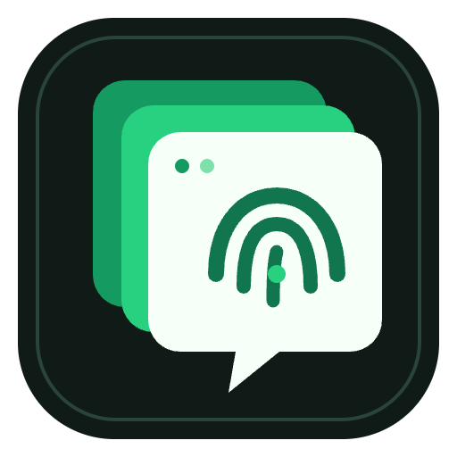
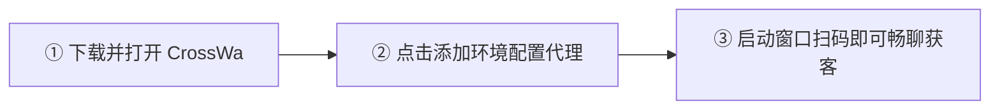



  

<h1 align="center">CrossWa Desktop</h1>

  <strong>专为外贸 B2B、跨境电商及海外本地化团队打造的 WhatsApp 多账号指纹隔离获客工作台</strong>

  <a href="#-核心特性">核心特性</a> •
  <a href="#-界面预览">界面预览</a> •
  <a href="#-安装与下载">下载安装</a> •
  <a href="#-小白开箱-3-步上手">快速上手</a> •
  <a href="#-智能接待与知识库配置">智能接待</a> •
  <a href="#-常见问题-faq">常见问题</a> •
  <a href="#-官方支持与商务咨询">联系我们</a>

  
  
  
  
  
  
  

---

## 💡 为什么选择 CrossWa Desktop？

在传统出海获客和外贸多账号运营中，团队往往面临 **“指纹关联封号频繁”**、**“跨国多语言沟通迟缓”**、**“AI 自动回复机械生硬导致客户流失”** 以及 **“电脑卡顿无法多开”** 等痛点。

**CrossWa Desktop** 将专业的指纹浏览器沙箱、双向即时机器翻译、轻量化本地拟人 AI 接待引擎与 MCP 开放生态深度整合，为出海业务打造一套零门槛、低成本、高转化的桌面级工作台。

| 功能板块 | 核心能力与实战优势 |
| :--- | :--- |
| 🛡️ **硬件级指纹环境隔离** | 独立分配 Canvas、WebGL、AudioContext、时区与系统字体指纹，搭配独享 Socks5/HTTP 代理 IP，全方位防账号串联 |
| 🌐 **即时双向聊天翻译** | 支持输入即时双向互译（中英、中西、中法、中阿、中俄等），打字自动翻译上屏，客户消息秒显中文，彻底消除语言障碍 |
| 🤖 **内置外贸拟人接待引擎** | 本地人设（`persona.md`）、阶梯报价单（`products.md`）与常见答疑（`faq.md`）可视化编辑，客户闲聊自然承接，杜绝冰冷机械味 |
| 🔌 **开放生态 MCP 协议** | 内置标准 Model Context Protocol（MCP）服务器，支持无缝对接外部获客智能体与自定义自动化脚本 |
| ⚡ **极致轻量低资源占用** | 深度优化后台 Chromium 实例资源分配，支持非活跃窗口自动节能休眠，4G 内存轻薄本也能轻松稳定多开 5~10 个环境 |
| 🔒 **商业级底层安全防护** | 核心业务与控制链路全量采用底层 **V8 机器字节码（.jsc）** 编译加固，严格限制本地安全沙盒访问 |

---

## 📥 安装与下载

请前往 [GitHub Releases 页面](https://github.com/crosswa-official/CrossWa-Desktop/releases/latest) 直接点击下载：

| 版本文件 | 文件大小 | 适用场景 | 官方下载通道 |
| :--- | :--- | :--- | :--- |
| **CrossWa-Setup-v1.3.11.exe** | ~185 MB | **标准安装版（推荐）**：支持自动安装、生成桌面图标与静默更新 | [🚀 点击高速直连下载](https://github.com/crosswa-official/CrossWa-Desktop/releases/download/v1.3.11/CrossWa-Setup-v1.3.11.exe) |
| **CrossWa-portable-v1.3.11.exe** | ~185 MB | **绿色免安装版**：单文件解压即用，适合 U 盘携带或临时机房部署 | [📦 点击高速直连下载](https://github.com/crosswa-official/CrossWa-Desktop/releases/download/v1.3.11/CrossWa-portable-v1.3.11.exe) |

> **系统要求**：Windows 10 / Windows 11 (64位操作系统)，建议具备 4GB 以上系统内存。

---

## 📖 小白开箱 3 步上手

1. **第一步：下载并启动**
   - 下载并运行 `CrossWa-Setup-v1.3.11.exe`，安装完成后打开桌面上的 **CrossWa** 图标。
2. **第二步：新建环境并绑定代理**
   - 点击主界面顶部「**添加环境**」，输入环境名称（例如：*欧洲客户接待01*）。
   - 填入你购买的海外 Socks5 或 HTTP 独享代理 IP，点击「保存环境」。
3. **第三步：扫码登录与开启翻译**
   - 点击「**启动**」打开独立指纹窗口，使用 WhatsApp 扫码登录。
   - 聊天界面右侧实时翻译栏已自动就绪，直接打中文即可一键翻译发送给海外买家！

---

## 🤖 智能接待与知识库配置

CrossWa 拥有完全去 AI 味的拟人化交流机制：

1. 打开主界面「**AI 接待设置**」面板。
2. 填入你的大模型 API Key（支持 DeepSeek、OpenAI 或各类兼容第三方中转源）。
3. 使用内置的可视化编辑器配置三大知识库：
   - 👤 **业务人设（`persona.md`）**：定义接待身份（如：*我是 CrossWa 业务经理 Dean，性格沉稳专业，对待客户如同老朋友*）。
   - 📦 **产品与报价（`products.md`）**：填入商品型号、规格、起订量（MOQ）与阶梯价格。
   - ❓ **常见问答（`faq.md`）**：填写运费政策、交期、样品打样、DDP 门到门发货等常见问题解答。
4. **效果**：当海外客户打招呼、闲聊生活、询问价格时，系统会自动结合上下文以资深外贸业务员的口吻自然回应，告别冰冷机械的套路式回复。

---

## ❓ 常见问题 (FAQ)

<b>Q1: 杀毒软件或 Windows Defender 提示“未知的发布者”？</b>

因本软件属于独立闭源商业分发，并采用了底层 V8 机器字节码编译保护商业逻辑，未购买微软昂贵的 EV 签名证书前，系统可能会弹出常规风险提示。点击「更多信息」->「仍要运行」即可放心使用。

<b>Q2: 为什么我的多开环境打不开海外网页？</b>

每个环境是完全隔离的沙盒，网络依赖于你所填写的独立代理 IP。请确保代理 IP 处于有效连通状态，并开启了对海外节点的访问权限。

<b>Q3: 更换新电脑，原来的聊天记录和环境会丢失吗？</b>

CrossWa 所有环境的独立 Cookie、缓存与指纹均保存在本地目录中。你可以使用软件内置的「环境备份/恢复」功能一键无缝打包迁移到任意新电脑。

---

## 💬 官方支持与商务咨询

如有大客户批量授权、海外获客定制需求或遇到任何技术配置问题，欢迎通过以下官方渠道直接联系：

- ✈️ **Telegram 官方客服**：[@crosswa](https://t.me/crosswa)
- 📢 **Telegram 官方频道**：[https://t.me/crosswa](https://t.me/crosswa)
- 📧 **商务合作与咨询邮箱**：[crosswa88@gmail.com](mailto:crosswa88@gmail.com)

---

  <i>Copyright © 2026 CrossWa Team. All rights reserved.</i>

